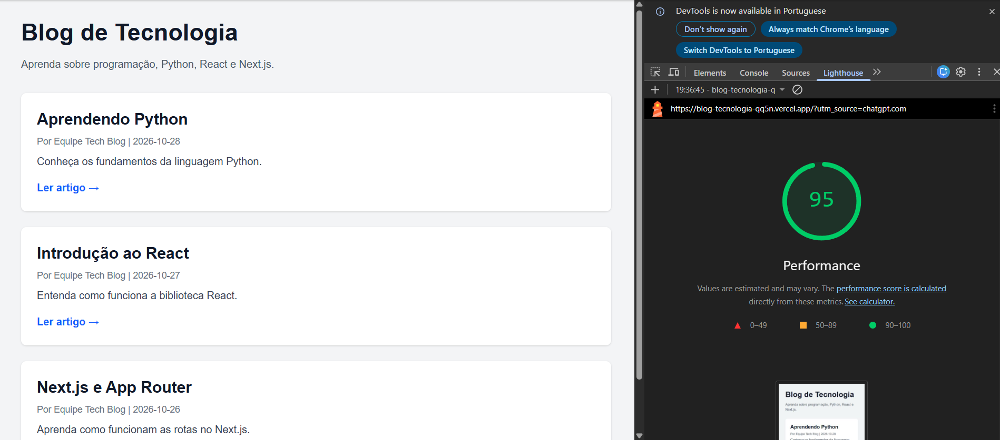
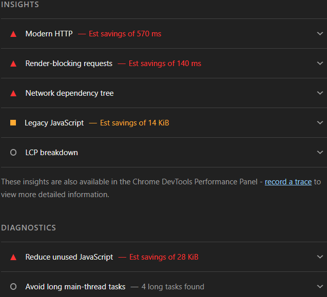

# Blog de Tecnologia

Aplicação front-end desenvolvida com Next.js, React,
TypeScript e Tailwind CSS, com artigos sobre programação,
Python, React e Next.js.

## Site publicado

https://blog-tecnologia-qq5n.vercel.app

## Tecnologias utilizadas

- Next.js
- React
- TypeScript
- Tailwind CSS
- ESLint
- GitHub Actions
- Vercel
- Lighthouse

## Como executar

1. Instale as dependências:

   npm ci

2. Inicie o projeto:

   npm run dev

3. Acesse http://localhost:3000

## Testes e validações

- npm run lint
- npm run test
- npm run build

Os quatro testes automatizados passaram durante a
validação do projeto.

## Pipeline CI/CD

O projeto utiliza GitHub Actions para automatizar:

- Instalação de dependências.
- Verificação de código com ESLint.
- Execução de testes automatizados.
- Build de produção.
- Deploy automático na Vercel.

A validação ocorre em pushes e pull requests para
a branch main.

O deploy ocorre após a validação bem-sucedida
de um push na branch main.

## Otimização de performance

O projeto foi submetido a uma análise de performance
utilizando o Lighthouse do Chrome DevTools.

O objetivo foi identificar gargalos, otimizar recursos
e comparar os resultados antes e depois das alterações.

### Gargalos identificados

- Requisições que bloqueavam a renderização.
- JavaScript legado.
- JavaScript não utilizado.
- Tarefas longas na thread principal.
- Carregamento desnecessário de fontes personalizadas.
- Pré-carregamento automático de páginas.

### Melhorias aplicadas

- Remoção das fontes Geist e Geist Mono.
- Utilização de fontes nativas do sistema.
- Simplificação do CSS global.
- Remoção de referências de código desnecessárias.
- Desativação do prefetch automático dos artigos.
- Adição de três capas otimizadas em WebP.
- Redimensionamento das imagens para 640 x 320 pixels.
- Utilização do componente Image do Next.js.
- Configuração de suporte a WebP e AVIF.
- Lazy loading nas imagens secundárias.
- Priorização do carregamento da primeira imagem.
- Definição das dimensões das imagens para evitar CLS.
- Minificação automática pelo build de produção do Next.js.

O projeto original não possuía imagens nos artigos.
As capas foram adicionadas já otimizadas para demonstrar
as técnicas de compressão e carregamento sob demanda.

Não foi necessário substituir bibliotecas, pois o
projeto já possuía poucas dependências principais.

## Comparativo de performance

| Métrica | Antes | Depois (mediana) | Melhoria |
|---|---:|---:|---:|
| FCP | 1,0 s | 1,0 s | Estável |
| LCP | 2,6 s | 2,4 s | 7,7% |
| TBT | 150 ms | 110 ms | 26,7% |
| CLS | 0 | 0 | Estável |
| Speed Index | 1,0 s | 1,0 s | Estável |

### Medições após a otimização

| Métrica | Teste 1 | Teste 2 | Teste 3 |
|---|---:|---:|---:|
| Performance | 97 | Não registrado | 98 |
| FCP | 1,0 s | 1,0 s | 1,0 s |
| LCP | 2,4 s | 2,5 s | 2,3 s |
| TBT | 110 ms | 240 ms | 50 ms |
| CLS | 0 | 0 | 0 |
| Speed Index | 1,0 s | 1,0 s | 1,0 s |

### Melhor resultado obtido

- Performance inicial: 95 pontos.
- Melhor performance final: 98 pontos.
- Ganho observado: 3 pontos.
- Redução do LCP: 11,5%.
- Redução do TBT: 66,7%.
- Redução de tarefas longas: de 4 para 2 ocorrências.

## Relatórios do Lighthouse

### Antes da otimização

### Diagnósticos iniciais

### Depois da otimização

### Métricas finais

## Conclusão

As otimizações permitiram obter melhorias nas métricas
de carregamento e processamento do navegador, mesmo
com a inclusão de três imagens no projeto.

A pontuação de performance passou de 95 para até
98 pontos nas medições realizadas.

Foi utilizada a mediana de três testes finais para
reduzir a influência das variações do Lighthouse.

Como foi realizada apenas uma medição inicial, não é
possível atribuir toda a melhoria exclusivamente às
alterações implementadas.

O projeto demonstra a aplicação prática de técnicas
de otimização de performance em aplicações web modernas.

## Autor

David Alves

Projeto desenvolvido durante o curso de Desenvolvedor
Full Stack Python da EBAC.
